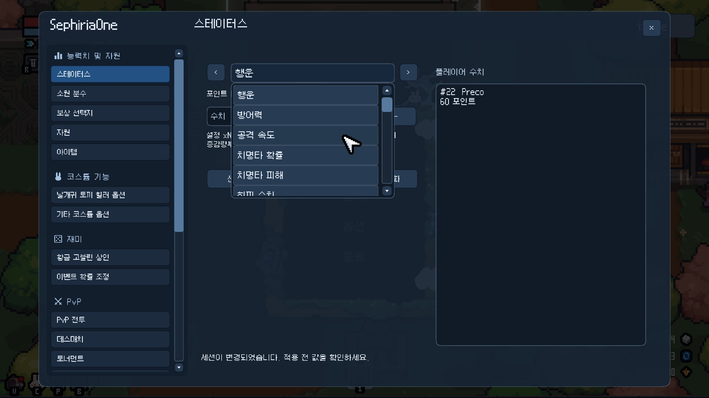
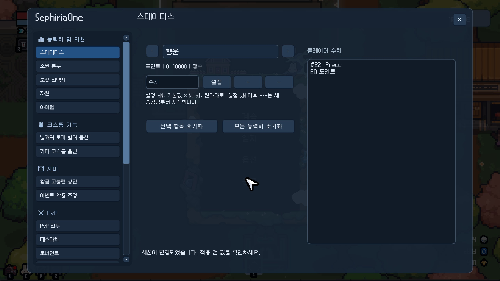
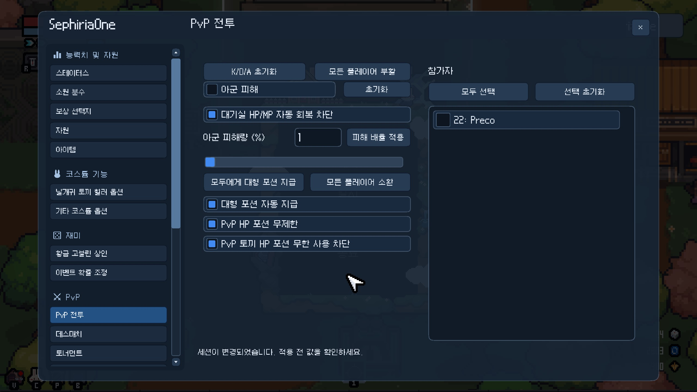
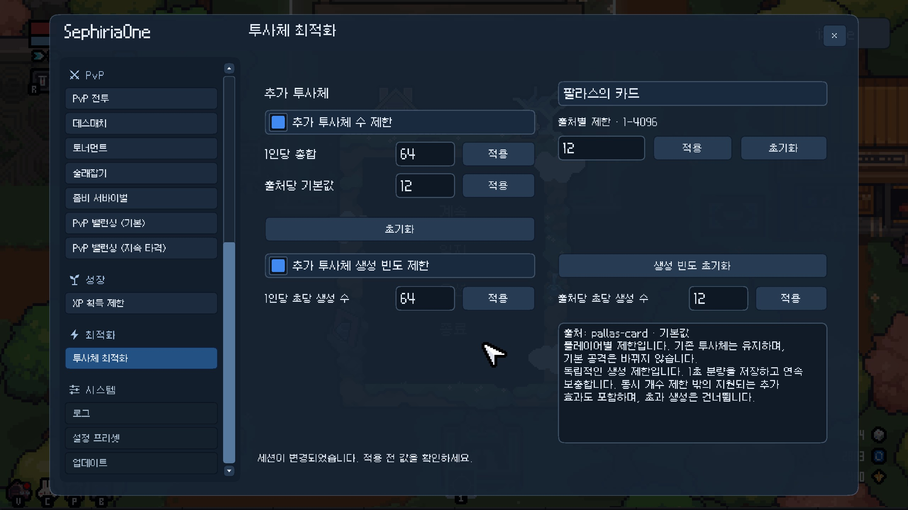

# SephiriaOne

**한국어** | [English](README-en.md)

> 개인적으로 놀려고 만든 잡탕 모드 (aka. 금수저런)

ESC 메뉴 우상단에서 모드 메뉴를 열 수 있습니다.

## 설치 방법

- [릴리즈](https://github.com/preco21/SephiriaOne/releases)에서 받은 ZIP 파일내 SephiriaOne 폴더를 압축 해제합니다.
- 게임 설치 경로(Steam > `Sephiria` 우클릭 > 관리 > 로컬 파일 탐색)에서 `Sephiria/AddOns` 폴더를 찾아 위 내용물을 폴더째로 넣습니다. 만약 `AddOns` 폴더가 없다면 직접 생성합니다. 최종 폴더 경로가 이렇게 되어야 합니다: `/Sephiria/AddOns/SephiriaOne`

## 모드 기능

- 기본 스테이터스 배수 변경 - 예를 들어, 행운 스탯을 캐릭터의 3배로 설정하거나 마법서가속을 3배 더 빠르게 설정할 수 있습니다.
- 소원 분수 개수 변경
- 보상 선택지 배수 변경
- 주사위/잎/인벤토리 배수 변경
- 닉네임 색상 변경 (본 모드 사용자만)
- 황금고블린 스폰 기능
- 날개귀 토끼를 이용한 힐러 포지션 추가
- 힐러 포지션 밀어주기용 박쥐 너프 기능
- 동료 빌드 밀어주기용 코스튬 옵션 (콜린 기본 지급 외)
- 항아리 스폰 확률 변경
- [무작위 이벤트 방 등장 확률 배수 변경](docs/random-events.md) (헌혈, 오벨리스크, 마법 분수 등)
- PvP 기능 및 콘텐츠: 기본적인 팀킬 모드 + 데스매치, 토너먼트, 술래잡기, 좀비 서바이벌
- 적절한 데미지를 위한 PvP 밸런싱, 참가자 선택 및 열외 기능
- 사기 석판 지급 기능(보은, 천국): 천국은 더미데이터로만 존재하는 석판이나 어쨋든 잘 동작해서 추가했습니다.
- 기본으로 얻은 아이템 판매 (마음의짐 포함) 허용
- 투사체 최적화 기능 (레이드 모드 12인+ 해방검, 일로니카, 팔라스 등 랙 유발 빌드를 쓰는 사람이 있을 경우 필수 옵션)
- 등등..

## 개발 관련

- OpenAI Codex - Astra `xhigh` effort + [superpowers](https://github.com/obra/superpowers) + [REA](https://github.com/morluto/rea)로 작업했습니다. 
- [Visual Studio 2026](https://visualstudio.microsoft.com/downloads/)가 필요합니다. 설치시 인스톨러에서 `.Net desktop development` 개발 도구를 함께 설치해야 빌드가 가능합니다.
- 개발 자료는 [문서 색인](docs/README.md)에서 찾을 수 있습니다. 일반 개발 지식, 게임 도메인 조사 결과, 기능별 설계와 참고 자료를 `docs/`에 정리했습니다. 다른 AI 에이전트도 이 자료를 참고하여 작업하도록 `AGENTS.md`에 안내되어 있습니다. GitHub 계정이 있다면 우상단 `Fork` 기능을 활용하여 손쉽게 사본을 만들 수 있습니다.
- 수정 후 빠르게 게임에서 결과물을 확인할 수 있도록 배포 스크립트(Deploy Mod)가 내장되어 있습니다. `scripts/Deploy-Mod.ps1` 또는 Visual Studio 솔루션의 상단 `Deploy Mod` 버튼을 이용하세요. (로컬의 `C:\Program Files (x86)\Steam\steamapps\common\Sephiria\AddOns` 경로로 배포됩니다)

## 라이센스

GNU Affero General Public License (AGPL)

본 모드 수정시 더 많은 분들이 혜택을 누릴 수 있도록 소스코드를 공개해주시면 감사하겠습니다.

누구나 본 프로젝트의 코드와 산출물의 재배포/공유/판매/변경을 자유롭게 할 수 있습니다.

## 크레딧 (Attribution)

https://github.com/Mira090 님이 작성하신 모드를 레퍼런스로 참고하였습니다.

ありがとう！ Thanks! 
